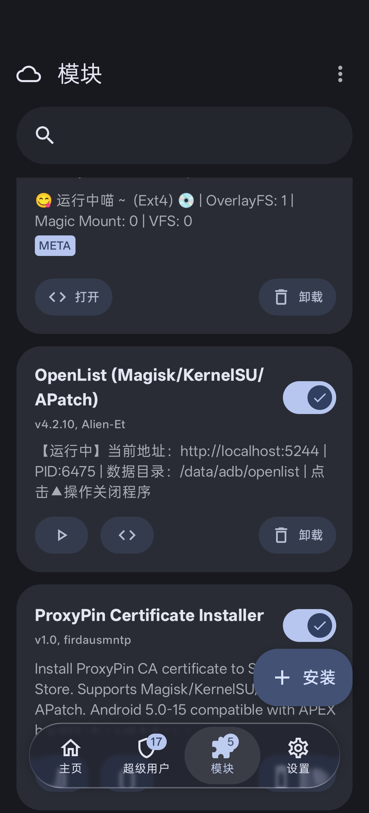
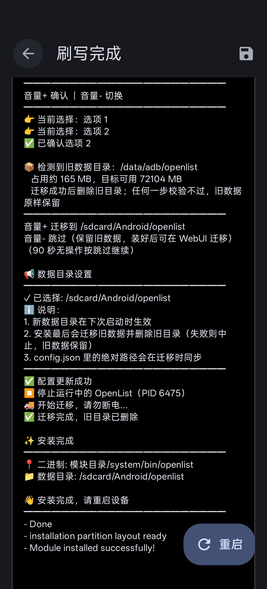
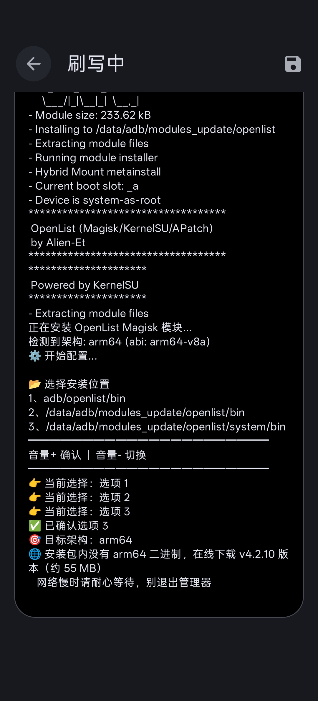
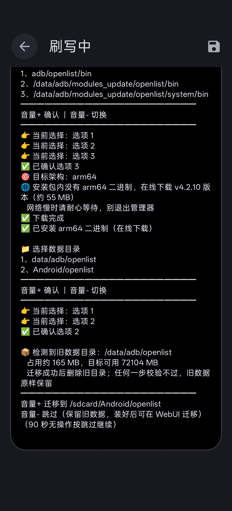

# OpenList Magisk/KernelSU/APatch 模块

> 第一次用？先看 **[安装包与更新通道说明](https://github.com/Alien-Et/OpenList-Magisk/discussions/39)** —— 5 个包怎么选、两条更新通道有什么区别，都在那里。

> **许可提示**：本模块的脚本、WebUI 与文档使用 **MIT** 许可；安装包内打包的 OpenList 可执行文件（`openlist-arm` / `openlist-arm64`）来自上游 [OpenListTeam/OpenList](https://github.com/OpenListTeam/OpenList)，使用 **AGPL-3.0**。两者许可不同，分发前请先看 [THIRD-PARTY.md](THIRD-PARTY.md)。

OpenList Magisk 模块将 [OpenList](https://github.com/OpenListTeam/OpenList) 文件服务器集成到 Android 系统中，通过 Magisk、KernelSU 或 APatch 以系统化方式运行，支持 ARM 和 ARM64 架构。

## 功能亮点

**安装**

- 三种二进制位置：`/data/adb/openlist/bin`、模块 `bin/`、模块 `system/bin`
- 两种数据目录：`/data/adb/openlist`、`/sdcard/Android/openlist`
- 更新安装时如果换了数据目录，可以顺手把旧数据迁过来（音量+ 迁移 / 音量- 跳过，默认跳过）
- 管理员账号交给网页向导创建，安装脚本不碰密码

**运行**

- 三家框架通用：Magisk / KernelSU / APatch，同一份 `control.sh`
- 开机自启：先等 `sys.boot_completed`，再等外部存储可写，`/sdcard` 挂载慢的机器也不会失败
- 自动识别访问地址：优先取默认路由的 `src`，避开 `172.16–31` 这类虚拟网卡

**WebUI（KernelSU / APatch）**

- 状态、启停、重启、打开网页
- 路径体检：列出所有二进制与数据目录，清理多余副本、切换、删除
- 所有版本：官方 Release 全列表，任意版本升级或回退
- 在线更新：可选下载镜像、显示下载进度、启动失败自动回滚
- 下载配置、管理员账号、存储、离线任务、日志、迁移
- 毛玻璃 + 大圆角，自动 / 浅色 / 深色主题

**命令行**

- `control.sh` 覆盖全部功能，Magisk 用户在终端直接调

## 截图展示

| 模块界面 | 安装完成 |
|---|---|
|  |  |

| 在线下载二进制 | 数据迁移 |
|---|---|
|  |  |

**WebUI 全页**（KernelSU / APatch 模块页面里的控制台）

 

## 系统要求

- Android 设备，支持 **arm / arm64 / x86 / x86_64** 四种架构
- Magisk v20.4 以上、KernelSU 或 APatch，任选其一
- Root 权限

## 安装包怎么选

一共 5 个包，分两个更新通道。**按架构挑一个装，以后它就自己跟着自己那条通道更新。**

| 包名 | 内含二进制 | 体积 | 适合谁 |
|---|---|---|---|
| `openlist-magisk-vX-arm64.zip` | arm64 | ~58 MB | **绝大多数手机，首选** |
| `openlist-magisk-vX-arm.zip` | arm | ~60 MB | 只有 arm32 的老设备 |
| `openlist-magisk-vX-amd64.zip` | amd64 | ~58 MB | x86_64 设备（WSA、部分掌机） |
| `openlist-magisk-vX-386.zip` | 386 | ~59 MB | x86 设备（模拟器） |
| `openlist-magisk-online.zip` | 无 | ~76 KB | 想省流量，安装时现下（~55 MB） |

全部挂在**同一个 `vX.Y.Z` Release** 下。4 个架构包跟上游 OpenList 走，`online` 由你手动触发构建 —— 同一个版本号可以只有 online 包，也可以两者都有。

**装错了也不会坏**：包里没有当前架构的二进制时，安装脚本会自动去下载，见下一节。

## 两条更新通道

| 通道 | 包内 `updateJson` | 版本号来源 | 更新日志 |
|---|---|---|---|
| 架构通道（arm64 / arm / amd64 / 386） | `update-<arch>.json` | 上游 OpenList 官方，CI 自动同步 | 上游 CHANGELOG |
| 在线通道（online） | `update.json` | 手动触发 `online.yml` 填版本号 | `CHANGELOG-ONLINE.md` |

装的是哪个包，模块管理器就检查哪条通道，两者互不干扰 —— 上游发新版不会把 online 用户的版本号顶掉，反过来也一样。

## online 包是什么：提前体验版

`openlist-magisk-online.zip` 和其它 4 个包是**同一个模块的两种装法**，区别只在「谁发版」和「包里有没有二进制」。

| | 4 个架构包（arm64 / arm / amd64 / 386） | online 包 |
|---|---|---|
| 谁发版 | CI 全自动 | **我手动触发** |
| 跟着谁走 | 上游 OpenList 官方 Release | 模块自身的脚本 / WebUI 改动 |
| 什么时候更新 | 上游发新版才更新 | 模块功能改了就发 |
| 包内二进制 | 自带，离线可装 | **无**，安装时下载约 55 MB |
| 版本号 | 上游版本号 | 我填的版本号 |

**要点：**

- **online 是提前体验版。** 模块的安装脚本、WebUI、控制逻辑改了什么，我手动发一版 online，装了它的用户立刻用上，不用等上游 OpenList 发新版。
- **代价是包里没有二进制。** 装的时候要联网下载对应架构的二进制（约 55 MB），或者装完在 WebUI 里点「立即更新」。断网装不了，除非提前把 `openlist-android-<arch>.tar.gz` 放进 Download 目录。
- **4 个架构包全自动，我不插手。** CI 只盯上游 OpenList 的 Release，上游一发就自动构建、自动发版，二进制版本号跟模块版本号严格对齐。
- **所以架构包用户拿不到我新改的模块功能**，得等上游下次发版。想提前用，改装 online 包 —— 之后你的更新就跟着 online 通道走，不会自动切回架构通道；想回去就重装一个架构包。

两个通道的版本号是同一套（`v4.2.10`、`v4.2.11`…）。同一个版本号可能同时有架构包和 online 包，也可能只有其中一个——**看 Release 里挂了哪些资产就知道**。

## 二进制获取顺序

`customize.sh` 按下面四级回退，任一成功就停：

1. **包内二进制** `$MODROOT/openlist-<arch>` —— 4 个架构包走这条
2. **Download 目录** `/sdcard/Download/openlist-android-<arch>.tar.gz` —— 提前放好就能离线装
3. **在线下载** —— 调 `control.sh fetch-bin <arch> <版本>`，直连 + 15 个国内镜像依次试，带 md5 校验
4. **全失败** —— `abort` 并打印手动下载地址与放置路径

在线下载走 `releases/download/vX.Y.Z/` 固定路径，不消耗 GitHub API 额度、不需要 token，并且**下载的二进制版本号与模块版本严格一致**。

> TWRP/recovery 里刷机且断网时，先按第 2 条把 `openlist-android-<arch>.tar.gz` 拷进 Download 目录，再刷 `online` 包也能装上。

## 框架兼容性

| 框架 | 模块系统 | 动作按钮 | 更新机制 | WebUI |
|---|---|---|---|---|
| Magisk | ✅ v20.4+ | ✅ | ✅ | ❌ 用「操作」按钮或终端 |
| KernelSU | ✅ | ✅ | ✅ | ✅ |
| APatch | ✅ | ✅ | ✅ | ✅ |

三家跑的是同一份 `control.sh`，行为一致，只是入口不同。卸载脚本会从 `service.sh` 读真实路径，迁到自定义目录也能清干净。

## 安装步骤

1. **下载模块**
   - 从 [GitHub Releases](https://github.com/Alien-Et/OpenList-Magisk/releases) 挑一个包（见 [安装包怎么选](#安装包怎么选)）
   - ARM64 设备拿 `openlist-magisk-vX-arm64.zip` 就行；不确定架构可以用 `openlist-magisk-online.zip`（约 76 KB，安装时自动识别并下载）

2. **安装配置**
   - 打开 Magisk 管理器、KernelSU 管理器 或 APatch 管理器
   - 选择"从本地安装"
   - 进入安装配置界面：
     - 选择二进制文件安装位置
     - 选择数据目录存储位置
     - 更新安装时如果检测到旧数据，会多问一句要不要一起迁过来
   - 包里没有对应架构的二进制时会自动在线下载，装的时候别断网

3. **完成安装**
   - 等待安装完成
   - 重启设备

## 使用说明

### 服务管理

- 开机自动启动：`late_start` 阶段先等 `sys.boot_completed`（最多 120 秒），数据目录在 `/sdcard` 或 `/storage` 时再等它可写（最多 180 秒），然后才拉起服务
- 管理器里点「操作」按钮（`action.sh`）可手动启停
- 状态写在 `module.prop` 的 description 里：运行时显示地址和 PID，停止时显示提示

### WebUI 控制台

| 区块 | 能做什么 |
|---|---|
| 状态 | 运行中/已停止、地址、PID；启停、重启、打开网页 |
| 目录 | 模块目录、数据目录、二进制路径，点击复制 |
| 路径体检 | 3 个二进制位置 + 2 个数据目录的占用；清理多余副本、切换数据目录、删除非当前目录 |
| 所有版本 | 全部 Release（含历史），一键升级或回退 |
| 版本与更新 | 检查更新、立即更新：后台下载、进度可见、起不来自动回滚 |
| 下载镜像 | 自动选择 / 直连 / 15 个国内镜像 / 自定义；自动模式按实测延迟排序 |
| 下载配置 | 端口、Token、目标路径、离线引擎、删除策略、预设路径 |
| 管理员账号 | 改用户名、改密码（走管理 API，在线生效，不重启） |
| 存储 | 列表、启用、禁用、全部重载 |
| 离线任务 | 进行中任务、进度、取消 |
| 迁移 | 数据目录 / 二进制点选迁移，迁移 = 移动（校验通过才删源） |
| 日志 | 「服务日志 / 程序输出」两页 |

### 访问方式
- Web 界面访问：`http://<设备IP>:5244`
- 首次打开会进入安装向导，按提示设置管理员账号和密码
- 完成向导前，WebUI 里存储、离线任务、设置会提示「还没有管理员账号」

### 数据存储

- 默认数据目录：`/data/adb/openlist/`，日志是同目录下的 `service.log` 和 `openlist.log`
- 下载镜像偏好存在 `<数据目录>/mirror.conf`，跟着数据目录走，模块更新不会丢
- **卸载默认保留数据**：只清理二进制。确实要连数据一起删，卸载前执行
  `touch /data/adb/modules/openlist/.delete_data_on_uninstall`，或卸载后手动 `rm -rf`

## 数据迁移说明
1. 安装时可选择数据目录与二进制位置
2. 装好后也能在 WebUI 迁移页随时改：选目标目录 → 「开始迁移」
3. 迁移 = 移动：复制、校验文件数与 data.db 的 md5 全部通过后，才同步 `config.json` 路径并删除源目录
4. 二进制迁移同理，校验一致后删除旧文件，不会同时留两份
5. 迁移完成后 WebUI 自动刷新状态、路径体检与日志

## 故障排除

### 常见问题
1. **无法访问服务**
   - 检查网络连接
   - 检查服务状态：`pgrep -f openlist`
   - 查看日志文件
   - 手动重启服务：`su -c /data/adb/modules/openlist/service.sh`

2. **IP 地址获取失败**
   - 确认 WiFi 或移动网络已连接
   - 检查网络接口状态
   - 查看模块日志

3. **服务无法启动**
   - 检查二进制文件权限
   - 确认数据目录可写
   - 查看详细日志

4. **检查更新没反应 / 更新失败**
   - 提示「GitHub 不可达，显示的是缓存版本」属于正常降级，版本列表来自上次缓存
   - 更新失败现在会带原因（`error=` 或退出码），日志页看 `service.log`
   - 国内直连 `api.github.com` 经常不通，可把 PAT 写进模块目录 `.github_token`（额度 60 → 5000 次/小时）
   - 下载走镜像：「下载镜像」里选「自动选择」，或指定某个镜像

5. **重启后没有自动启动**
   - 看 `/data/adb/modules/openlist/service.log` 最后几行
   - 卡在「等待外部存储就绪」是 `/sdcard` 挂载慢，最多等 180 秒，不用管
   - 手动跑一次确认二进制的数据目录没问题：`su -c /data/adb/modules/openlist/service.sh`

6. **WebUI 打不开**
   - Magisk 没有 WebUI 机制，只能用「操作」按钮或终端 `control.sh`
   - KernelSU / APatch 在模块卡片里点 WebUI

7. **online 包装不上 / 提示缺少二进制**
   - 这个包**不含二进制**，安装时要联网下载（约 55 MB），断网就会中止
   - 断网装的话，先把 `openlist-android-<arch>.tar.gz` 放进 `Download` 目录，安装脚本会优先用它
   - 已经装好、只想换 OpenList 版本：WebUI 里「立即更新」可以升级或回退，不影响模块本身

### 手动操作
- 停止服务：`su -c pkill -f openlist`
- 启动服务：`su -c /data/adb/modules/openlist/service.sh`
- 查看日志：`cat /data/adb/modules/openlist/service.log`

## 更新说明

- 模块更新分两条通道：架构包看 `update-<arch>.json`，online 包看 `update.json`；都是 `versionCode` 变大才提示，互不干扰
- 模块更新只替换模块文件，不动数据目录
- WebUI 里的「立即更新」是给二进制用的：后台下载、显示进度、起不来自动回滚
- 版本列表只走 GitHub 官方 API；不通时用上次缓存并标注「离线缓存」
- 二进制下载可走国内镜像，自动模式按实测延迟从快到慢排

## 更新日志

> 这里记的是**模块自身**的改动。OpenList 二进制的版本跟上游同步，由 CI 自动构建，见 [两条更新通道](#两条更新通道)。

### v4.2.10 (2026-11-23)

- **修复** WebUI 管理员账号密码框输不进字：不再用 `type=password`（部分 WebView 的密码管理器/自动填充会抢焦点，输入框直接失效），改 `type=text` + `-webkit-text-security:disc` 遮罩，管理员卡片加「显示密码」切换；Token 框同步处理
- **修复** 点「立即更新」只弹一句「更新失败」且没有任何原因：更新改成后台跑（`update-bg` 用 `setsid` 独立会话 + `update-status` 轮询），宿主 exec 返回/超时不会再掐断下载；失败原因优先显示 `error=`，没有就显示 stderr / 退出码，页面刷新还能接着上次的进度
- **修复** WebUI 更新提示文案与实际流程不符：下载、md5 校验、解压都在服务运行中完成，只在替换二进制前短暂停服务
- **重构** 「所有版本」列表只走 GitHub 官方 API（`per_page=100` 分页翻到底），去掉国内代理与 HTML 兜底；限流时明确报「GitHub 限流」，可把 PAT 写进模块目录 `.github_token`（60 → 5000 次/小时）
- **优化** 迁移页的二进制迁移与数据目录统一成点选胶囊，去掉多余输入框
- **修复** 重启后不自动启动：service.sh 原来先 `mkdir` 数据目录再等 `sys.boot_completed`，数据目录在 `/sdcard` 时会因 FUSE 未挂载直接退出；改为先等启动完成、外部存储可写再动目录
- **新增** WebUI「下载镜像」：下拉列出 15 个国内镜像并显示实测延迟（自动选择 / 直连 / 自定义），选择持久化到 `<数据目录>/mirror.conf`；自动模式按实测延迟从快到慢排（缓存 30 分钟）
- **优化** 无代理环境：API 失败时版本列表/最新版本用缓存兜底（`stale=1`），指定版本安装跳过 API 直接拼下载地址走镜像；下载过程显示「已下载 N MB」
- **优化** WebUI 打开速度：各区块并行加载、GitHub API 走 gzip（5.39 MB → 412 KB）、路径体检与版本列表本地缓存
- **新增** 安装界面可选数据迁移：更新安装时检测到旧数据且换了目录，会多一次音量键确认（音量+ 迁移并删源 / 音量- 跳过，90 秒无操作按跳过）；校验不过则旧数据原样保留
- **新增** 安装包内随附 `LICENSE`（MIT 副本）、`LICENSE-AGPL-3.0.txt`（AGPL-3.0 全文）与 `THIRD-PARTY.md`（第三方组件说明）；README 顶部补许可提示，并把徽章补齐为 release / license / bundled binary / arch / platform
- **重构** 产物拆成 5 个：4 个单架构包（arm64 / arm / amd64 / 386，各带自己的 `updateJson` 走独立更新通道）+ 1 个不含二进制的 `online.zip`（约 76 KB）
- **新增** 安装时四级回退取二进制：包内 → Download 目录 → 在线下载（复用 `control.sh` 的镜像列表与 md5 校验）→ 中止并给手动指引；下载的二进制版本与模块版本严格对齐

> 本次更新只测试到「WebUI 能正常用」这一步，没有做完整回归，可能还有没挖出来的隐藏 bug。遇到问题请到仓库提 issue。

### v4.1.10 (2026-02-03)

- **修复** versionCode 计算逻辑，支持三位版本号（v4.1.10 → 4110）
- **修复** 安装脚本占位符替换问题
- **修复** sed 替换时变量被错误展开的问题
- **优化** action.sh 启停服务的输出提示信息
- **改进** 移除冗余的占位符验证逻辑

## 贡献
- 欢迎提交 Issue 和 Pull Request
- 问题反馈：[GitHub Issues](https://github.com/Alien-Et/OpenList-Magisk/issues)
- 安装包怎么选、更新通道的区别、使用经验交流：[Discussions](https://github.com/Alien-Et/OpenList-Magisk/discussions)

## 许可证
模块自身的脚本、WebUI 与文档基于 [MIT 许可证](LICENSE) 发布。

4 个架构包内打包的 `openlist` 二进制来自 [OpenList 官方 Release](https://github.com/OpenListTeam/OpenList/releases)，遵循上游 **AGPL-3.0** 许可证，对应源码见 [OpenListTeam/OpenList](https://github.com/OpenListTeam/OpenList)。`online` 包不含二进制，安装时下载的那份同样属于上游。

安装包内随附 `LICENSE`（MIT 副本）、`LICENSE-AGPL-3.0.txt`（AGPL-3.0 全文）与 `THIRD-PARTY.md`（第三方组件说明），装到设备上也能随时查阅。

## 文档

- [01. 整体架构](docs/01.整体架构.md)
- [02. control 命令](docs/02.control命令.md)
- [03. WebUI 界面](docs/03.WebUI界面.md)
- [04. 更新与回滚](docs/04.更新与回滚.md)
- [05. 迁移与路径](docs/05.迁移与路径.md)
- [06. 安装选项矩阵](docs/06.安装选项矩阵.md)
- [07. 总结](docs/07.总结.md)
